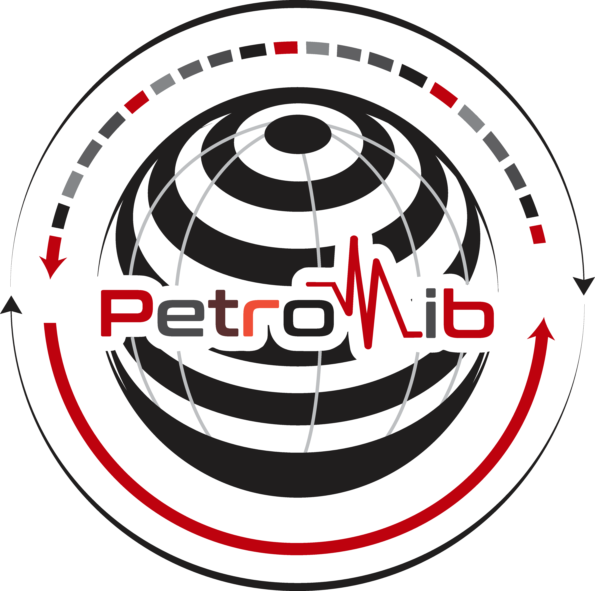

[](https://petrolib.readthedocs.io/en/latest/?badge=latest) [](https://badge.fury.io/py/petrolib) [](https://pepy.tech/project/petrolib)     
#  Petrolib: A Lightweight Package for Petrophysical Evaluation 

This is a python package designed to help users perform petrophysical analysis, from loading well data to net pay, rock typing and in-place volumes:

* Volume of Shale using various methods like Clavier, Stieber and Larionov methods, and neutron-density separation
* Porosity - Effective and Total porosities using the density, neutron-density (gas corrected), Wyllie's sonic and Raymer-Hunt-Gardner methods
* Water Saturation - Archie, and the shaly sand models Simandoux, Indonesia, Waxman-Smits and dual water
* Permeability - Timur, Coates, Morris-Biggs and Wyllie-Rose
* Formation water resistivity - Arps temperature correction, Rwa and Rw from salinity
* Rock typing - rock quality index, flow zone indicator, discrete rock types, Winland R35 pore throat classes and Lorenz coefficients
* Saturation-height - capillary pressure from height and Leverett J-function fits
* Lithology - M-N and MID parameters, and a multi-mineral solver
* Net pay - cutoff flags, Techlog-style summation and cutoff sensitivity
* Volumetrics and uncertainty - STOIIP, GIIP and Monte Carlo water saturation
* Invasion - flushed zone saturation, movable hydrocarbon index, and Rw and Vshale from the SP
* Geomechanics and rock physics - dynamic elastic moduli, brittleness, UCS, overburden, Eaton pore and fracture pressure, Gassmann fluid substitution
* Electrofacies - unsupervised k-means facies from logs
* Machine learning - fill missing log curves with AutoGluon, with one model for the field or one per well

In addition to estimating these parameters, log plots are automatically displayed for proper interpretation. Also a pay summary result/dataframe is produced to help quantify the over-all quality of the reservoirs. Cutoff such as the porosity, shale volume and water saturation are applied to flag pay regions. The pay summary include:

* net, gross and not net thicknesses
* % net-to-gross 
* average volume of shale
* average porosity
* bulk volume of water
* water saturation (pore volume weighted)
* permeability
* porosity thickness (PHIH) and hydrocarbon pore thickness (HCPV)

Interestingly, the parameters are computed and displayed only for the zones of interest picked. Plots such as neutron-density, Pickett, Hingle, Buckles, Winland, RQI, Lorenz, M-N, MID, Thomas-Stieber, movable hydrocarbon, pressure and mechanical property plots are available for reservoir assessment. The pay summary is saved to a formatted Excel workbook. Geolocations of the wells can also be visualised.

### Package layout

| Subpackage | Contents |
|---|---|
| `petrolib.io` | `load_well` (LAS, DLIS, CSV, Excel), `load_las`, `load_dlis`, `dlis_summary`, `load_table`, `Zonation` (well tops), `write_pay_summary` |
| `petrolib.mnemonics` | `find_curves`, `standardize`, `resolve`, `register_aliases` |
| `petrolib.processing` | `set_alias`, `process_data`, `trim`, `model_facies`, `electrofacies` |
| `petrolib.petrophysics` | the `Quanti` workflow, and the equations: `shale`, `porosity`, `saturation`, `fluids`, `permeability`, `rocktype`, `capillary`, `lithology`, `netpay`, `volumetrics`, `uncertainty`, `geomechanics` |
| `petrolib.plots` | log tracks (`tripleCombo`, `plotLogs`, ...), cross plots (`crossPlot`, `picketPlot`, `hinglePlot`), petrophysics plots (`bucklesPlot`, `winlandPlot`, `rqiPlot`, `lorenzPlot`, `mnPlot`, `midPlot`, `thomasStieberPlot`, `movableHydrocarbonPlot`, `histogramPlot`, `cutoffPlot`, `paySummaryPlot`, `volumePlot`, `swUncertaintyPlot`), geomechanics plots (`mechanicalPlot`, `pressurePlot`, `rockPhysicsPlot`) and maps (`plotLoc`) |
| `petrolib.stats` | `Correlation`, `displayFreq` |
| `petrolib.automl` | `LogImputer` and the `petrolib-impute` command |

### Installation

```python
pip install -U petrolib

pip install -U "petrolib[maps]"     # well maps with basemaps (geopandas, contextily)
pip install -U "petrolib[dlis]"     # DLIS files (dlisio)
pip install -U "petrolib[automl]"   # filling missing logs with AutoGluon (Python >= 3.10)
pip install -U "petrolib[all]"
```

### Quick tutorial

#### 1. Load data
```python
#import necessaries
from pathlib import Path
from petrolib.io import load_las, Zonation
from petrolib.processing import process_data
from petrolib.petrophysics import Quanti
from petrolib.plots import tripleCombo, plotLog

#load data
well_path = Path(r"./15_9-19.las")
tops_path = Path(r'./well tops.csv')

df, las = load_las(well_path, return_csv=True, curves=['GR', 'RT', 'NPHI', 'RHOB'])
print(df)
```

#### Any file, any mnemonics
Curves are recognized from an alias table of common vendor mnemonics, then from the curve
descriptions in the file. `standardize` renames them to DEPTH, GR, RT, NPHI, RHOB, DT, ... and
converts NPHI in % to a fraction, RHOB in kg/m3 to g/cc and DT in us/m to us/ft.

```python
from petrolib.io import load_well, load_dlis, dlis_summary
from petrolib.mnemonics import find_curves, standardize, register_aliases

dlis_summary('well.dlis')                       # frames and channels of a DLIS file
df = load_well('well.dlis', standardize=True)   # or .las, .csv, .xlsx; depth in m
find_curves(['DEPT', 'GR_EDTC', 'AT90', 'TNPH', 'RHOZ', 'DTCO'])
# {'DEPTH': 'DEPT', 'GR': 'GR_EDTC', 'RT': 'AT90', 'NPHI': 'TNPH', 'RHOB': 'RHOZ', 'DT': 'DTCO'}
register_aliases('RT', ['MY_DEEP_RES'])         # mnemonics of your company

pp = Quanti(raw_df, zn, ztop, zbot, fm)         # also works on raw vendor names: 'RT' is matched to AT90, ILD, ...
print(pp.curves)
```

#### 2. Display Triple-Combo and Zonation Plot
```python
df = process_data(df, 'GR', 'RT', 'NPHI', 'RHOB')

#triple combo
%matplotlib inline
tripleCombo(df, 'DEPTH', 'GR', 'RT', 'NPHI', 'RHOB', ztop=3300,
               zbot=3450, res_thres=10, fill='right', palette_op='rainbow', limit='left')
               
#zone plot
zones = Zonation(df, path=tops_path)
zones.plotZone('DEPTH', ['GR', 'RT', 'RHOB', 'NPHI', 'CALI'], 3300, 3600, '15_9-19')
plotLog(df, 'DEPTH', ['GR', 'RT', 'RHOB', 'NPHI', 'CALI'], 3300, 3600, '15_9-19')
```

A tops file with several wells and other column names can be read with
`Zonation(df, path='tops.csv', well='15_9-19', top_col='Top', bot_col='Base', zone_col='Zone')`.

#### 3. Pay Summary Computation
```python
#calling the zonation object to extra info
ztop, zbot, zn, fm = zones()

#Petrophysics
pp = Quanti(df, zn, ztop, zbot, fm, 'DEPTH', 'GR', 'RT', 'NPHI', 'RHOB', use_mean=True)
vsh = pp.vshale(method='clavier', show_plot=True, palette_op='cubehelix', figsize=(9,12))
por = pp.porosity(method='neutron_density', rhob_shale=2.45, nphi_shale=.33, show_plot=True, figsize=(10, 12))
sw = pp.water_saturation(method='indonesia', rw=.05, rsh=3., show_plot=True, figsize=(10, 12))
perm = pp.permeability(method='timur', show_plot=True, figsize=(9, 10))
flags = pp.flags(por_cutoff=.12, vsh_cutoff=.5, sw_cutoff=0.8, show_plot=True, palette_op='cubehelix', figsize=(20, 15))

ps = pp.paySummary(name='15-9_F1A')

#save results to excel: dark blue header, ROCK yellow, RES green, PAY red rows, and a Log Data sheet
pp.save(file_name='Pay Summary')
```

#### 4. Petrophysics functions and plots
```python
import pandas as pd
from petrolib import petrophysics as ptr
from petrolib.plots import bucklesPlot, winlandPlot, lorenzPlot, cutoffPlot

result = pd.concat(flags)

#rock typing
result['FZI'] = ptr.fzi(result['Perm'], result['PHIE'])
result['DRT'] = ptr.drt(result['FZI'])
result['R35'] = ptr.winland_r35(result['Perm'], result['PHIE'])

#shaly sand saturation with your own parameters
result['SW_WS'] = ptr.waxman_smits(result['PHIT'], result['RT'], qv=.2, rw=.05, temp_c=90)

#cutoff sensitivity and uncertainty
sens = ptr.cutoff_sensitivity(result, cutoff='por', values=[.04, .06, .08, .1, .12])
mc = ptr.monte_carlo_archie(result['PHIE'], result['RT'], rw=(.02, .03, .045), m=(1.8, 2., 2.2))

bucklesPlot(result, hue='VShale')
winlandPlot(result)
lorenzPlot(result, depth='DEPTH')
cutoffPlot(sens)

#geomechanics; vs_castagna estimates shear when no DTS was run
mech = result.join(ptr.elastic_moduli(result['RHOB'], result['DT'], result['DTS']))
mech['BI'] = ptr.brittleness(mech['E'], mech['PR'])
sv = ptr.overburden(result['DEPTH'], result['RHOB'])
ph = ptr.hydrostatic_pressure(result['DEPTH'])
shale = result['VShale'] > .7                                   # samples for the compaction trend
pore = ptr.pore_pressure_eaton(sv, ph, result['DT'], ptr.normal_compaction_trend(result['DEPTH'], result['DT'], fit=shale))
```

#### 5. Fill missing logs with AutoGluon
```python
from petrolib.automl import LogImputer

#one model for the field, scored on a well it never saw
imp = LogImputer(targets='DT', features=['GR', 'RT', 'NPHI', 'RHOB'], well_col='WELL', time_limit=600)
filled = imp.fit_fill(wells_df, holdout_wells=['15_9-F-1A'])   # scores on a held-out well, then refits on all
print(imp.scores_)                                             # RMSE, MAE and R2 on the held-out well
imp.plot_qc(filled[filled.WELL == '15_9-F-1A'], 'DT')
imp.save()

#one model per well; wells with too few DT values use a field-wide fallback model
imp = LogImputer(targets='DT', features=['GR', 'RT', 'NPHI', 'RHOB'], well_col='WELL', per_well=True)
filled = imp.fit_fill(wells_df, holdout_fraction=.2)          # scores on a 20% block blanked mid-well
filled['DT_MODEL']                                             # 'well' or 'field': the model that filled each value
```

or from the command line:

```
petrolib-impute wells.csv --targets DT --features GR RT NPHI RHOB --well-col WELL --holdout-wells 15_9-F-1A --time-limit 600
petrolib-impute wells.csv --targets DT --well-col WELL --per-well --holdout-fraction 0.2
```

### Upgrading from petrolib 1.x

The 1.x modules still import, with a deprecation warning, and will be removed in 3.0:

| 1.x | 2.0 |
|---|---|
| `petrolib.file_reader` | `petrolib.io` |
| `petrolib.plots.Zonation` | `petrolib.io.Zonation` |
| `petrolib.procs` | `petrolib.processing` |
| `petrolib.workflow` | `petrolib.petrophysics` |
| `petrolib.interp` | `petrolib.plots` |
| `petrolib.utils` | `petrolib.exceptions` |

Results differ from 1.x because of fixes: the Archie exponent, OR-ed net flags, swapped cutoffs in the pay summary, user parameters dropped between steps, GR endpoints (now P5/P95), net thickness with data gaps, the permeability equation (now Timur) and the sonic matrix default (now 55.5 us/ft, sandstone).

#### See the  [tutorial repo](https://github.com/joshua-atolagbe/tutorials) and [official website](www.petrolibs.com) for more


### Citation

If petrolib helps your work, please cite it:

> Atolagbe, J. (2026). *Petrolib: A Lightweight Package for Petrophysical Evaluation* (Version 2.0.0) [Computer software]. https://github.com/joshua-atolagbe/petrolib

```bibtex
@software{atolagbe_petrolib_2026,
  author  = {Atolagbe, Joshua},
  title   = {Petrolib: A Lightweight Package for Petrophysical Evaluation},
  version = {2.0.0},
  year    = {2026},
  url     = {https://github.com/joshua-atolagbe/petrolib},
  license = {MIT}
}
```

Cite the version you used (`petrolib.__version__`). The "Cite this repository" button on GitHub gives the same reference, from `CITATION.cff`.
